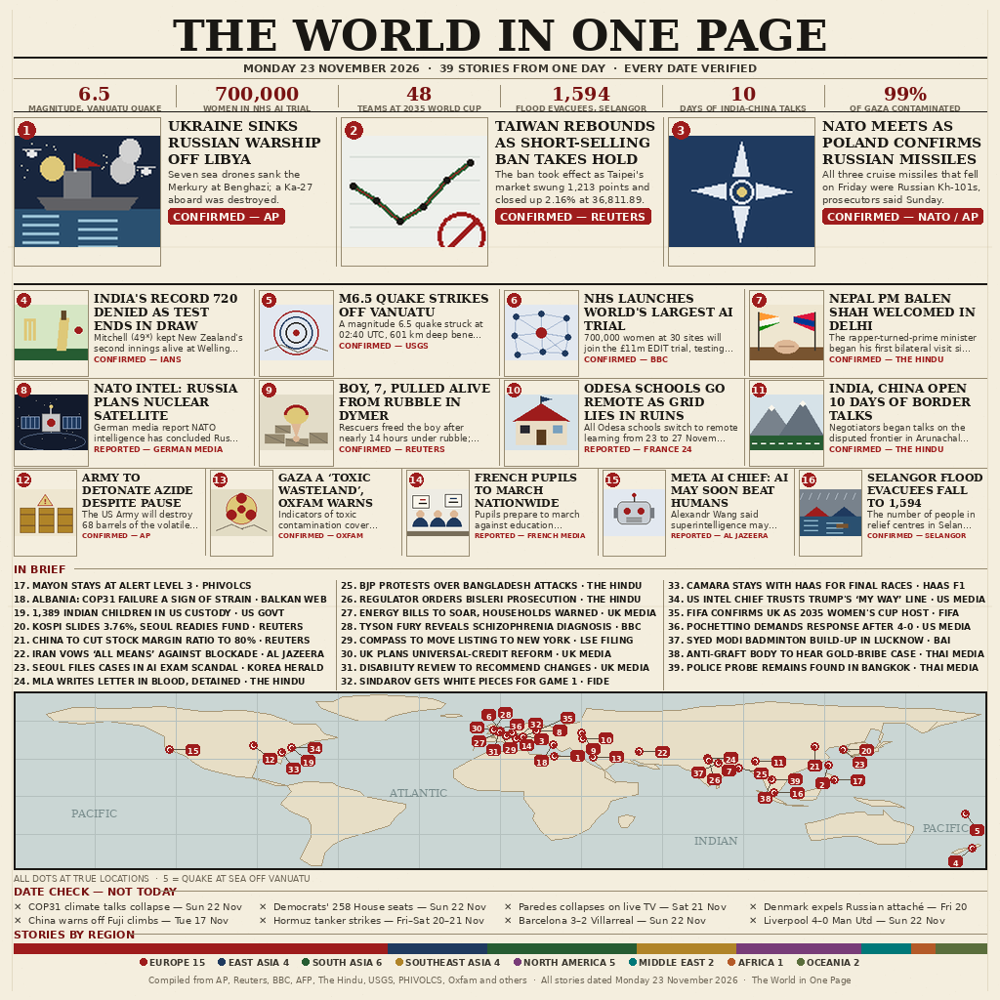

# The World in One Page — Monday 23 November 2026

[](https://make.fun/bounty/news-image-20261123?utm_source=github&utm_medium=readme&utm_campaign=news-image-20261123)
[](https://make.fun/bounty/news-image-20261123?utm_source=github&utm_medium=readme&utm_campaign=news-image-20261123)
[](https://make.fun/bounty/news-image-20261123?utm_source=github&utm_medium=readme&utm_campaign=news-image-20261123)

A dense serif newspaper front page that sums up the full day of world news
from **Monday 23 November 2026** in one image: **39 stories** — 3 heroes,
13 illustrated middles, 23 briefs — across **8 regions**, with a numbered
world map (every pin at its true latitude/longitude), a DATE CHECK box that
excludes near-miss stories from other days, and verification tags
(CONFIRMED / REPORTED + source) on every story.

## The image



## How to build

```bash
python3 draw.py    # renders entry.png (1024x1024, deterministic)
python3 main.py    # copies entry.png, byte-verified
```

`draw.py` needs only Pillow and the DejaVu fonts. `main.py` uses the
standard library only.

## Stories

Top stories of the day: Ukraine's sea drones sink the Russian corvette
Merkury off Libya; Taiwan's market rebounds as its short-selling ban takes
hold; NATO meets in Brussels as Poland confirms the fallen missiles were
Russian Kh-101s. Every story was verified against original sources (AP,
Reuters, BBC, AFP, The Hindu, USGS, PHIVOLCS, Oxfam and others) and dated
to Monday 23 November 2026 — stories from 20–22 November are listed in the
DATE CHECK box instead.
